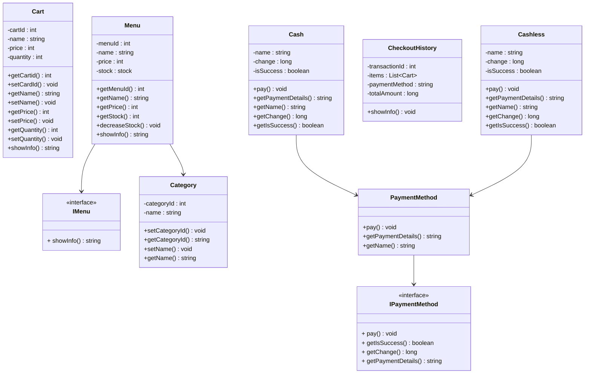
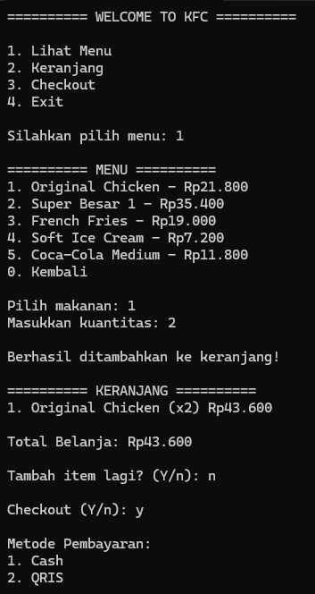
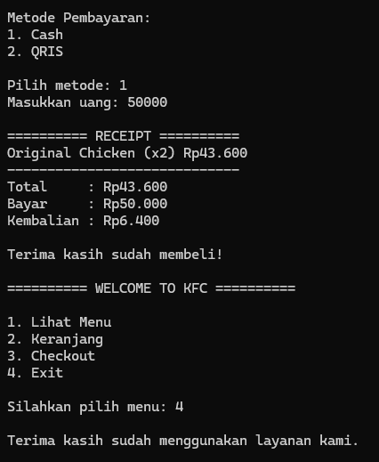

# Homework 4 - Java & .NET
## Struktur Kelas Utama menggunakan Class Diagram (Mermaid)


## Konsep OOP yang Digunakan
1. Ecapsulation
2. Inheritance
3. Abstraction
4. Polymorphism
5. Interface

## Cara Menjalankan Aplikasi
### Java :
1. Masuk ke folder homework-java
2. Buka CMD (Command Prompt)
3. Jalankan perintah: ```mvn compile && java -cp target/classes com.homework.java.App```

### .NET :
1. Masuk ke folder .net
2. Buka CMD (Command Prompt)
3. Jalankan perintah: ```dotnet run --project src/Homework4.Console```

## Screenshot Hasil Program
<p align="center">

</p>
<p align="center">

</p>